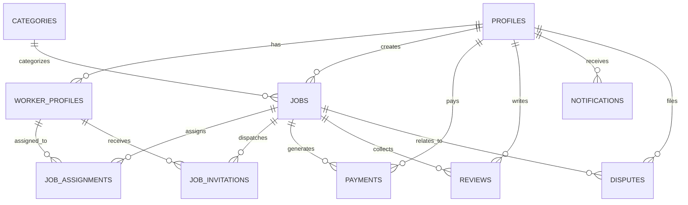

# CREWLINK — Database Schema Documentation

## Database Engine
- **Engine:** PostgreSQL 15+ (Hosted on Supabase)
- **Extensions:** `uuid-ossp`, `postgis`

---

## Entity Relationship Overview

---

## 1. Tables & Schemas

### `profiles`
Links directly to Supabase Auth `auth.users(id)` via foreign key with cascading delete.
- `id` (UUID, Primary Key)
- `full_name` (TEXT, NOT NULL)
- `email` (TEXT, UNIQUE, NOT NULL)
- `phone` (TEXT)
- `role` (`user_role`: `'customer'`, `'worker'`, `'admin'`, default: `'customer'`)
- `profile_picture_url` (TEXT)
- `created_at` (TIMESTAMPTZ, default `now()`)
- `updated_at` (TIMESTAMPTZ, default `now()`)

### `worker_profiles`
Specialized attributes for worker accounts.
- `user_id` (UUID, Primary Key, references `profiles(id)`)
- `skills` (TEXT[] array)
- `experience_years` (NUMERIC)
- `hourly_rate` (NUMERIC(10, 2))
- `daily_rate` (NUMERIC(10, 2))
- `location` (GEOGRAPHY(Point, 4326), spatial index GIST)
- `location_address` (TEXT)
- `preferred_radius_km` (NUMERIC(5, 2), default: 15.00)
- `verification_status` (`verification_status`: `'pending'`, `'approved'`, `'rejected'`)
- `availability_status` (`availability_status`: `'available'`, `'busy'`, `'offline'`)
- `location_sharing_enabled` (BOOLEAN)
- `last_location_update` (TIMESTAMPTZ)
- `rating` (NUMERIC(3, 2), default: 5.00)
- `rating_count` (INT, default: 0)
- `completed_jobs` (INT, default: 0)
- `no_show_count` (INT, default: 0)
- `is_crew_leader` (BOOLEAN, default: false)
- `crew_leader_id` (UUID, references `worker_profiles(user_id)`)
- `id_proof_url` (TEXT)
- `id_proof_type` (TEXT)
- `verification_notes` (TEXT)
- `verified_at` (TIMESTAMPTZ)
- `verified_by` (UUID, references `profiles(id)`)

### `categories`
Standardized labor and job ticket categories.
- `id` (UUID, Primary Key)
- `name` (TEXT, UNIQUE)
- `slug` (TEXT, UNIQUE)
- `description` (TEXT)
- `icon` (TEXT)
- `min_workers` (INT, default: 1)
- `default_hourly_rate` (NUMERIC(10, 2), default: 300.00)
- `is_active` (BOOLEAN, default: true)

### `jobs`
Core job ticket entity representing a customer's labor request.
- `id` (UUID, Primary Key)
- `job_code` (TEXT, UNIQUE, e.g., `CL-2501`)
- `customer_id` (UUID, references `profiles(id)`)
- `category_id` (UUID, references `categories(id)`)
- `category_name` (TEXT)
- `title` (TEXT)
- `description` (TEXT)
- `workers_needed` (INT, >= 1)
- `duration_hours` (INT, >= 1)
- `scheduled_date` (DATE)
- `scheduled_time` (TIME)
- `location_lat` (NUMERIC(10, 6))
- `location_lng` (NUMERIC(10, 6))
- `location_address` (TEXT)
- `location_geom` (GEOGRAPHY(Point, 4326), spatial index GIST)
- `search_radius_km` (NUMERIC(5, 2), default: 15.00)
- `status` (`job_status`: `'draft'`, `'pending_crew'`, `'partially_allocated'`, `'crew_ready'`, `'confirmed'`, `'in_progress'`, `'completed'`, `'cancelled'`, `'disputed'`)
- `rate_per_worker_hour` (NUMERIC(10, 2))
- `estimated_total` (NUMERIC(10, 2))
- `final_total` (NUMERIC(10, 2))
- `crew_allocated_count` (INT, default: 0)
- `cancellation_reason` (TEXT)

### `job_invitations`
Dispatched invitations to eligible workers.
- `id` (UUID, Primary Key)
- `job_id` (UUID, references `jobs(id)`)
- `worker_id` (UUID, references `worker_profiles(user_id)`)
- `status` (`invitation_status`: `'pending'`, `'accepted'`, `'declined'`, `'expired'`)
- `offered_pay` (NUMERIC(10, 2))
- `distance_km` (NUMERIC(6, 2))
- `expires_at` (TIMESTAMPTZ)
- `responded_at` (TIMESTAMPTZ)

### `job_assignments`
Confirmed crew members participating in a job.
- `id` (UUID, Primary Key)
- `job_id` (UUID, references `jobs(id)`)
- `worker_id` (UUID, references `worker_profiles(user_id)`)
- `status` (`assignment_status`: `'assigned'`, `'checked_in'`, `'in_progress'`, `'completed'`, `'no_show'`, `'cancelled'`)
- `assigned_at` (TIMESTAMPTZ)
- `checked_in_at` (TIMESTAMPTZ)
- `completed_at` (TIMESTAMPTZ)
- `worker_pay` (NUMERIC(10, 2))
- `notes` (TEXT)

### `payments`
Razorpay transaction records.
- `id` (UUID, Primary Key)
- `job_id` (UUID, references `jobs(id)`)
- `customer_id` (UUID, references `profiles(id)`)
- `razorpay_order_id` (TEXT, UNIQUE)
- `razorpay_payment_id` (TEXT, UNIQUE)
- `razorpay_signature` (TEXT)
- `amount` (NUMERIC(10, 2))
- `currency` (TEXT, default: 'INR')
- `status` (`payment_status`: `'pending'`, `'authorized'`, `'captured'`, `'refunded'`, `'failed'`)
- `payment_method` (TEXT)
- `raw_response` (JSONB)

### `reviews`
Post-completion ratings and feedback.
- `id` (UUID, Primary Key)
- `job_id` (UUID, references `jobs(id)`)
- `reviewer_id` (UUID, references `profiles(id)`)
- `reviewee_id` (UUID, references `profiles(id)`)
- `role` (`user_role`)
- `rating` (INT, 1-5)
- `comment` (TEXT)

### `notifications`
Database-backed push/inbox notifications.
- `id` (UUID, Primary Key)
- `user_id` (UUID, references `profiles(id)`)
- `title` (TEXT)
- `message` (TEXT)
- `type` (TEXT)
- `is_read` (BOOLEAN, default: false)
- `link` (TEXT)
- `metadata` (JSONB)

### `disputes`
Customer or worker dispute submissions.
- `id` (UUID, Primary Key)
- `job_id` (UUID, references `jobs(id)`)
- `reported_by` (UUID, references `profiles(id)`)
- `worker_id` (UUID, references `worker_profiles(user_id)`)
- `reason` (TEXT)
- `details` (TEXT)
- `status` (`dispute_status`: `'open'`, `'under_review'`, `'resolved'`, `'dismissed'`)
- `resolution_notes` (TEXT)
- `resolved_by` (UUID, references `profiles(id)`)
- `resolved_at` (TIMESTAMPTZ)

---

## 2. PostgreSQL Functions and RPC

1. **`public.handle_new_user()`**:
   Triggered on `auth.users` insert. Creates matching row in `public.profiles` and optionally `public.worker_profiles`.
2. **`public.find_eligible_workers(p_lat, p_lng, p_radius_km, p_category_name, p_scheduled_date, p_limit)`**:
   PostGIS spatial query utilizing `ST_DWithin` and spatial indexing. Excludes workers with conflicts or non-approved status, and orders candidates by distance, rating, and completed jobs.
3. **`public.confirm_crew_allocation(p_job_id, p_worker_ids)`**:
   Transactional crew assignment with row-level locks on `jobs`. Automatically updates job status to `partially_allocated` or `crew_ready` and dispatches in-app notifications.
4. **`public.is_admin()`**:
   Security definer helper checking whether the caller has the admin role in `public.profiles`.
